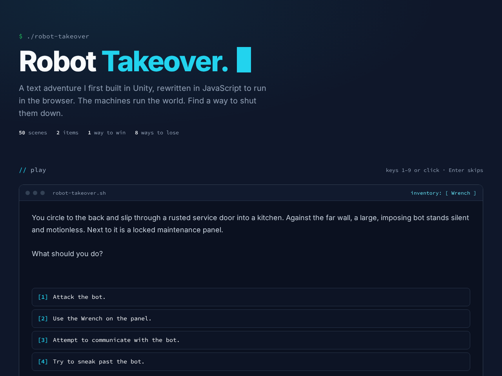

# **Robot_Takeover**

---

 

## **Description 📃**
- Robot Takeover is a text adventure set in the year 3095, where a sentient network of machines has seized control of the world. You are one of the last survivors, and every choice you make decides whether humanity takes the world back or the bots rule forever.
- It was first built as a C# project in Unity and rewritten in plain JavaScript so it runs in any browser.

## **functionalities 🎮**
- 50 scenes, with 1 way to win and 8 ways to lose.
- An inventory: some choices give you an item, and some choices only appear when you carry the right one (pick up the Wrench and a locked panel opens).
- Story text types out like a terminal; press Enter or click the text to skip the typing.
- Keyboard and mouse controls, and it works on phones.
- Respects the "reduce motion" setting by showing text instantly.
 

## **How to play? 🕹️**
- Open `index.html` in a browser.
- Read the scene, then pick a choice by pressing its number key (1–9) or clicking it.
- Press Enter or click the story text to skip the typing animation.
- Keep an eye on your inventory in the top-right of the game window.
- Find the way to shut the machines down. If you reach GAME OVER, choose Main Menu to try again.

 

## **Screenshots 📸**

 

 
